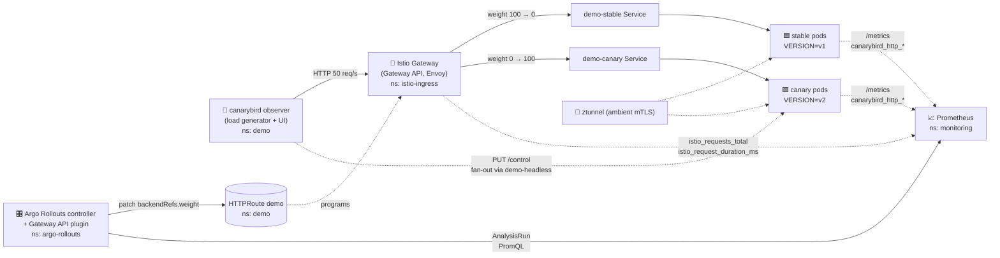

# 🚀 Argo Rollouts on kind — Canary with Kubernetes Gateway API, Istio (ambient) HTTPRoute & Prometheus Analysis, demoed with canarybird 🐤

> **Production-grade lab, enterprise-minded defaults.** The workload is [canarybird](https://github.com/thiha-min-thant/canarybird) (`ghcr.io/thiha-min-thant/canarybird:dev`): one image, a rollout is just `VERSION=vN`, and a live grid shows the split clients *actually* observe next to the weight the controller *claims*. Everything is version-pinned, digest-aware, least-privilege, and GitOps-friendly. Verified against upstream releases on **24 Oct 2026**. All manifests and scripts referenced below live in this repo — see [What's in this repo](#-whats-in-this-repo).

---

## 📋 Table of contents

1. [Architecture & design first](#1--architecture--design-first)
2. [Version matrix](#2--version-matrix-latest-as-of-2026-10-24)
3. [Prerequisites & tooling](#3--prerequisites--tooling)
4. [Create the kind cluster](#4--create-the-kind-cluster)
5. [Install Gateway API CRDs](#5--install-gateway-api-crds)
6. [Install Istio (ambient mode) with Helm](#6--install-istio-ambient-mode-with-helm)
7. [Create the Istio Gateway (Gateway API)](#7--create-the-istio-gateway-gateway-api)
8. [Install Prometheus (kube-prometheus-stack)](#8--install-prometheus-kube-prometheus-stack)
9. [Install Argo Rollouts + Gateway API plugin](#9--install-argo-rollouts--gateway-api-plugin)
10. [Least-privilege RBAC for the plugin](#10--least-privilege-rbac-for-the-plugin)
11. [Deploy canarybird (Services, HTTPRoute, Rollout, observer)](#11--deploy-canarybird)
12. [AnalysisTemplate (SLO-based gates)](#12--analysistemplate-slo-based-gates)
13. [Demo 1 — healthy canary 🟢](#13--demo-1--healthy-canary-)
14. [Demo 2 — break the canary at runtime, automatic rollback 🔴](#14--demo-2--break-the-canary-at-runtime-automatic-rollback-)
15. [Advanced: header-based smoke routing](#15--advanced-header-based-smoke-routing)
16. [Hardening & enterprise suggestions](#16--hardening--enterprise-suggestions)
17. [Troubleshooting](#17--troubleshooting)
18. [Cleanup](#18--cleanup)
19. [Sources](#19--sources)

---

## 📁 What's in this repo

```text
versions.env                         # every version pin, sourced by the scripts — bump here only
manifests/
  kind-config.yaml                   # §4  3-node kind cluster, digest-pinned node image
  gateway.yaml                       # §7  istio-ingress namespace + Gateway (Gateway API)
  kps-values.yaml                    # §8  kube-prometheus-stack values (trimmed for kind)
  istio-envoy-podmonitor.yaml        # §8  scrape Envoy stats from the Istio gateway
  argo-rollouts-values.yaml          # §9  Argo Rollouts chart values + Gateway API plugin init container
  rollouts-gwapi-rbac.yaml           # §10 demo namespace (ambient, PSA restricted) + least-privilege Role
  demo-app.yaml                      # §11 Services (stable/canary/headless), HTTPRoute, canarybird Rollout, observer
  canarybird-podmonitor.yaml         # §11 scrape canarybird /metrics, tag samples with the ReplicaSet hash
  analysis-template.yaml             # §12 SLO gates: gateway success/p99 + app success/p95 for the canary hash
  advanced/rollout-header-routing.yaml   # §15 header-based smoke routing variant of the Rollout
  hardening/mesh-security.yaml           # §16 STRICT mTLS + gateway-only AuthorizationPolicy
  hardening/argocd-ignore-differences.yaml  # §16 Argo CD ignoreDifferences snippet
scripts/
  install-tools.sh                   # §3  kubectl-argo-rollouts (checksum-verified) + istioctl
  setup.sh                           # §4–§12 end-to-end, idempotent (builds + kind-loads the image if not pullable)
  build-canarybird.sh                # build ghcr.io/thiha-min-thant/canarybird:dev from a local checkout, kind load [--push]
  port-forward.sh                    # observer UI :8080, gateway :8081, Prometheus :9090, Rollouts dashboard :3100
  watch.sh                           # phase / weights / AnalysisRuns, refreshed every 3 s
  demo-1-healthy.sh                  # §13 next VERSION, healthy (add `promote` to pass the manual gate)
  demo-2-rollback.sh                 # §14 next VERSION + runtime chaos on it only (add `undo` to recover)
  cleanup.sh                         # §18
```

Every script pins `kubectl --context kind-rollouts-lab` / `helm --kube-context`, so other contexts in your kubeconfig are never touched. The scripts are bash; from **fish**, run them the same way (`bash scripts/...`). Fast path:

```bash
bash scripts/install-tools.sh && bash scripts/setup.sh
bash scripts/port-forward.sh        # separate terminal → http://localhost:8080 (canarybird grid)
bash scripts/demo-1-healthy.sh      # then: bash scripts/demo-1-healthy.sh promote
bash scripts/demo-2-rollback.sh     # then: bash scripts/demo-2-rollback.sh undo
```

---

## 1. 🏗️ Architecture & design first

### What we are building



### Design decisions (and why)

| Decision | Choice | Rationale |
|---|---|---|
| Demo workload | **canarybird** `ghcr.io/thiha-min-thant/canarybird:dev` | One image for every version (`VERSION`/`COLOR` env), so the rollout path is exercised without waiting on a build. Scenarios (`error-spike`, `slow-burn`, `not-ready`, …) are applied at **runtime** to one version only. Exposes its own Prometheus metrics. |
| Traffic source | A single **observer** pod outside the HTTPRoute, load-generating **through the gateway** | Its grid shows the split clients observe vs. `setWeight`; its Break-something panel fans out to every rollout pod via a headless Service. Rollout pods run with `LOADGEN_ENABLED=false`. |
| Traffic router | **Gateway API plugin** (not the legacy Istio VirtualService integration) | Vendor-neutral: the same Rollout manifest works on Istio, Envoy Gateway, kgateway, Cilium, AWS LBC… Argo only touches `HTTPRoute.spec.rules[].backendRefs[].weight`. |
| Mesh mode | **Istio ambient** (ztunnel + optional waypoint) | Matches a modern EKS/AKS fleet, no sidecars → app pods can run under PSA `restricted`, lower cost. Gateway → pod hop is mTLS via HBONE. |
| Gateway placement | Gateway in `istio-ingress`, HTTPRoute in `demo`, cross-namespace via `allowedRoutes` selector | Platform team owns the Gateway; app teams own routes (Gateway API persona model). |
| Gateway API channel | **standard** v1.6.3 | GA resources only. ≥ v1.5 ships a ValidatingAdmissionPolicy that blocks mixing channels — choose once per cluster. |
| Analysis | **Background** AnalysisRun from step 1, two vantage points: the **gateway's** Istio telemetry for the canary Service, and **canarybird's own** metrics selected by the canary ReplicaSet hash (`podTemplateHashValue: Latest`) | Edge view is app-agnostic; app view is version-agnostic (no hard-coded `v2` in the template). Failure on either → automatic abort → traffic back to stable. |
| Plugin delivery | Init container copies the plugin binary from a pinned OCI image (`file://`) | No runtime download from GitHub (supply-chain + air-gap friendly). |
| Kubernetes version | kind node **v1.37.0** (kind v0.33.0's default) | Istio's supported-releases page lists Kubernetes **1.32–1.37** for Istio 1.31.x (the 1.31.0 announcement said 1.32–1.36; 1.37 was added with later patch releases). `versions.env` keeps the 1.36.4 digest as a fallback. |

### Namespaces

| Namespace | Owner | Contents |
|---|---|---|
| `istio-system` | Platform | istiod, istio-cni, ztunnel |
| `istio-ingress` | Platform | `Gateway/demo-gateway` → auto-deployed Envoy `demo-gateway-istio` |
| `argo-rollouts` | Platform | Rollouts controller + plugin, dashboard |
| `monitoring` | Platform | kube-prometheus-stack (Prometheus Operator + Prometheus) |
| `demo` | App team | canarybird Rollout, Services (stable/canary/headless), HTTPRoute, AnalysisTemplate, PodMonitor, observer Deployment |

---

## 2. 📌 Version matrix (latest as of 2026-10-24)

| Component | Version | Notes |
|---|---|---|
| kind | **v0.33.0** (2026-08-26) | node image `kindest/node:v1.37.0@sha256:a1ed56cf…` (multi-arch amd64/arm64) |
| Kubernetes | **v1.37.0** | inside Istio 1.31's support window (1.32–1.37) |
| Gateway API CRDs | **v1.6.3** (standard) | released 2026-10-06 |
| Istio | **1.31.3** (2026-10-22) | charts now at `https://blob.istio.io/istio-release/charts` (GCP hosting retired) |
| Argo Rollouts | **v1.10.1** (2026-10-12), Helm chart `argo-rollouts-2.43.8` (2026-10-16) | |
| Gateway API traffic-router plugin | **v0.17.0** (2026-09-01), image `@sha256:bc40d5ed…` | requires Gateway API ≥ 1.2; `maxTrafficWeight > 100` support; ping-pong needs Rollouts ≥ 1.10 |
| kube-prometheus-stack | chart **92.13.1** (Prometheus Operator v0.94.1) | released 2026-10-24 |
| canarybird | `ghcr.io/thiha-min-thant/canarybird:dev` | ⚠️ not on ghcr.io yet (`release.yml` publishes semver + `latest` on `v*` tags only). `scripts/setup.sh` builds the tag from `CANARYBIRD_SRC` and `kind load`s it when the pull fails; `scripts/build-canarybird.sh --push` publishes it. |

All pins live in `versions.env`; the scripts source it. For the manual walkthrough below, load it once per shell. **bash** and **fish** both accept `source versions.env` (the file uses `$VAR`, not `${VAR}`):

```bash
source versions.env
# CLUSTER_NAME=rollouts-lab  KUBE_CONTEXT=kind-rollouts-lab
# K8S_NODE_IMAGE=kindest/node:v1.37.0@sha256:a1ed56cf…   GATEWAY_API_VERSION=v1.6.3
# ISTIO_VERSION=1.31.3   ARGO_ROLLOUTS_VERSION=v1.10.1   ARGO_ROLLOUTS_CHART_VERSION=2.43.8
# GWAPI_PLUGIN_VERSION=v0.17.0 (+ GWAPI_PLUGIN_IMAGE digest)   KPS_CHART_VERSION=92.13.1
# CANARYBIRD_IMAGE=ghcr.io/thiha-min-thant/canarybird:dev   CANARYBIRD_SRC=~/Code/github/canarybird
```

Walkthrough `kubectl` / `helm` snippets below use `$VAR` so they paste into fish after sourcing. §3.1–§3.3 (kind / plugin / istioctl downloads) are bash; from fish use `bash scripts/install-tools.sh` instead.

---

## 3. 🧰 Prerequisites & tooling

* Docker Desktop / Docker Engine (≥ 8 GB RAM, 4 CPU allocated), **cgroup v2** host
* `kubectl` ≥ 1.36 (within one minor of the 1.37 cluster), `helm` ≥ 3.16 or Helm 4 (verified with 4.3), `jq`, `curl`
* `scripts/install-tools.sh` performs §3.2 and §3.3 below with checksum verification and version checks. From fish: `bash scripts/install-tools.sh` (the copy-paste in §3.1–§3.3 is bash).
* Host arch must match the node image arch (kind images are multi-arch amd64/arm64; no cross-arch).

### 3.1 kind v0.33.0

```bash
# macOS / Linux via Go-less binary download (or: brew install kind)
KIND_OS=$(uname | tr '[:upper:]' '[:lower:]'); KIND_ARCH=$(uname -m | sed 's/x86_64/amd64/;s/aarch64/arm64/')
curl -Lo ./kind "https://kind.sigs.k8s.io/dl/v0.33.0/kind-${KIND_OS}-${KIND_ARCH}"
chmod +x ./kind && sudo mv ./kind /usr/local/bin/kind
kind version
```

### 3.2 Argo Rollouts kubectl plugin (checksum-verified)

```bash
OS=$(uname | tr '[:upper:]' '[:lower:]'); ARCH=$(uname -m | sed 's/x86_64/amd64/;s/aarch64/arm64/')
curl -LO "https://github.com/argoproj/argo-rollouts/releases/download/${ARGO_ROLLOUTS_VERSION}/kubectl-argo-rollouts-${OS}-${ARCH}"

# Published SHA-256 for v1.10.1 (from the GitHub release page):
#   linux-amd64  fb28a5ba80939aae8e6cb4c04c1e809d080938a2f0d03d496311fc643b4b92cd
#   linux-arm64  c677dec8cdf124b2ff60f475587ebd4a728015e512a1a1090a8c21b119ebbdf1
#   darwin-amd64 11d26b7b2e6f1df771bb69db773cc98d2722d256f44da16193631f6fd2866b13
#   darwin-arm64 e2bd92b6b56a6794a2ccc487c04a1c328a02240d1fa638809c80bff91e5b073b
sha256sum "kubectl-argo-rollouts-${OS}-${ARCH}"     # (macOS: shasum -a 256)

chmod +x "kubectl-argo-rollouts-${OS}-${ARCH}"
sudo mv "kubectl-argo-rollouts-${OS}-${ARCH}" /usr/local/bin/kubectl-argo-rollouts
kubectl argo rollouts version
```

### 3.3 istioctl (optional but recommended for `analyze` / `ztunnel-config`)

```bash
curl -L https://istio.io/downloadIstio | ISTIO_VERSION=${ISTIO_VERSION} sh -
sudo mv "istio-${ISTIO_VERSION}/bin/istioctl" /usr/local/bin/
istioctl version --remote=false
```

---

## 4. 🧱 Create the kind cluster

`manifests/kind-config.yaml` — 1 control-plane + 2 workers, image pinned by digest (required by the kind project for reproducibility):

```yaml
kind: Cluster
apiVersion: kind.x-k8s.io/v1alpha4
name: rollouts-lab
nodes:
  - role: control-plane
    image: kindest/node:v1.37.0@sha256:a1ed56cfb0e7b93589bdf97c8cd566405a265939e3620fc4f5de89adff580ae5
  - role: worker
    image: kindest/node:v1.37.0@sha256:a1ed56cfb0e7b93589bdf97c8cd566405a265939e3620fc4f5de89adff580ae5
  - role: worker
    image: kindest/node:v1.37.0@sha256:a1ed56cfb0e7b93589bdf97c8cd566405a265939e3620fc4f5de89adff580ae5
```

```bash
kind create cluster --config manifests/kind-config.yaml
kubectl cluster-info --context kind-$CLUSTER_NAME
kubectl get nodes -o wide
```

> 💡 **Kubernetes 1.37.0** is kind v0.33.0's default and is listed as supported for Istio 1.31.x on the [Istio supported-releases page](https://istio.io/latest/docs/releases/supported-releases/) (1.32–1.37). Staying inside the support window is a production habit worth keeping in the lab; if your platform's Istio matrix lags, swap to the `v1.36.4` digest kept in `versions.env`.

---

## 5. 🛣️ Install Gateway API CRDs

Install **before** Istio so istiod discovers the Gateway API types at startup. Use server-side apply (the CRDs are large).

```bash
kubectl apply --server-side -f \
  "https://github.com/kubernetes-sigs/gateway-api/releases/download/$GATEWAY_API_VERSION/standard-install.yaml"

kubectl get crd | grep gateway.networking.k8s.io
kubectl get validatingadmissionpolicies.admissionregistration.k8s.io   # safe-upgrades VAP shipped with the CRDs
```

> ⚠️ Gateway API ≥ 1.5 installs a **ValidatingAdmissionPolicy** that refuses to install experimental CRDs on top of standard ones (and refuses downgrades). Pick the channel deliberately; for this guide the **standard** channel has everything we need (`HTTPRoute` rule `name`, `backendRefs.weight`, `ListenerSet`).

---

## 6. 🕸️ Install Istio (ambient mode) with Helm

> 📦 Istio 1.31 retired the GCP-hosted artifacts. Charts: `https://blob.istio.io/istio-release/charts` (OCI alternative: `oci://ghcr.io/istio/release/charts/<chart>`). Images remain on Docker Hub.

```bash
helm repo add istio https://blob.istio.io/istio-release/charts
helm repo update

# Control plane
helm install istio-base istio/base -n istio-system --create-namespace \
  --version $ISTIO_VERSION --wait

helm install istiod istio/istiod -n istio-system \
  --version $ISTIO_VERSION --set profile=ambient --wait

# CNI node agent (ambient traffic redirection) — no platform override needed on kind.
# useAppArmorAnnotation=false: Kubernetes ≥ 1.30 deprecated the beta annotation; this
# cluster is 1.37 so use securityContext.appArmorProfile instead (Istio default is still
# the annotation for 1.29 compatibility).
helm install istio-cni istio/cni -n istio-system \
  --version $ISTIO_VERSION --set profile=ambient --set useAppArmorAnnotation=false --wait

# Data plane
helm install ztunnel istio/ztunnel -n istio-system \
  --version $ISTIO_VERSION --wait

helm ls -n istio-system
kubectl get pods -n istio-system
istioctl version   # optional
```

Expected: `istiod-*` (1/1), `istio-cni-node-*` ×3 and `ztunnel-*` ×3 (DaemonSets), all `Running`.

> 💡 No `istio/gateway` chart is needed: with the Gateway API, Istio **auto-deploys** an Envoy gateway Deployment/Service for every `Gateway` resource whose class is `istio`.

---

## 7. 🚪 Create the Istio Gateway (Gateway API)

`manifests/gateway.yaml` — platform-owned, cross-namespace route attachment restricted to the `demo` namespace:

```yaml
apiVersion: v1
kind: Namespace
metadata:
  name: istio-ingress
  labels:
    pod-security.kubernetes.io/enforce: baseline
---
apiVersion: gateway.networking.k8s.io/v1
kind: Gateway
metadata:
  name: demo-gateway
  namespace: istio-ingress
  annotations:
    # kind has no LoadBalancer implementation; expose as ClusterIP and port-forward.
    # Remove this annotation (or install cloud-provider-kind) to get a LoadBalancer.
    networking.istio.io/service-type: ClusterIP
spec:
  gatewayClassName: istio
  listeners:
    - name: http
      protocol: HTTP
      port: 80
      allowedRoutes:
        namespaces:
          from: Selector
          selector:
            matchLabels:
              kubernetes.io/metadata.name: demo
```

```bash
kubectl apply -f manifests/gateway.yaml
kubectl wait -n istio-ingress --for=condition=Programmed gateway/demo-gateway --timeout=120s
kubectl get gateway -n istio-ingress
kubectl get deploy,svc -n istio-ingress      # demo-gateway-istio
```

> 🔒 **Production:** add an `HTTPS` listener with `tls.certificateRefs` (cert-manager), set `hostnames` on routes, and tune the auto-deployed gateway (replicas/HPA/PDB/resources) through `spec.infrastructure.parametersRef` → ConfigMap, so the Gateway manifest stays declarative.

---

## 8. 📈 Install Prometheus (kube-prometheus-stack)

Minimal footprint for kind, but the same Operator CRDs (`PodMonitor`, `ServiceMonitor`) you run in production.

`manifests/kps-values.yaml`:

```yaml
# Trim what makes no sense on kind; keep the Operator + Prometheus
grafana:
  enabled: false
alertmanager:
  enabled: false
nodeExporter:
  enabled: false
kubeStateMetrics:
  enabled: false
defaultRules:
  create: false
# kind control-plane components bind to 127.0.0.1 → avoid noisy scrape failures
kubeControllerManager: { enabled: false }
kubeScheduler: { enabled: false }
kubeEtcd: { enabled: false }
kubeProxy: { enabled: false }
prometheus:
  prometheusSpec:
    retention: 6h
    # Discover PodMonitors/ServiceMonitors from any namespace, regardless of Helm release label
    podMonitorSelectorNilUsesHelmValues: false
    serviceMonitorSelectorNilUsesHelmValues: false
    resources:
      requests: { cpu: 100m, memory: 512Mi }
      limits: { memory: 1Gi }
```

```bash
helm repo add prometheus-community https://prometheus-community.github.io/helm-charts
helm repo update

# Pinned in versions.env (92.13.1 on 2026-10-24). To bump:
#   helm search repo prometheus-community/kube-prometheus-stack -o json | jq -r '.[0].version'
helm install kube-prometheus-stack prometheus-community/kube-prometheus-stack \
  -n monitoring --create-namespace --version "$KPS_CHART_VERSION" -f manifests/kps-values.yaml --wait

kubectl get svc -n monitoring   # expect: kube-prometheus-stack-prometheus (:9090)
```

Scrape Istio gateway (and any Envoy proxy) stats — `manifests/istio-envoy-podmonitor.yaml` (the canonical Istio sample for Prometheus Operator):

```yaml
apiVersion: monitoring.coreos.com/v1
kind: PodMonitor
metadata:
  name: envoy-stats-monitor
  namespace: istio-system
  labels:
    monitoring: istio-proxies
spec:
  selector:
    matchExpressions:
      - { key: istio-prometheus-ignore, operator: DoesNotExist }
  namespaceSelector:
    any: true
  jobLabel: envoy-stats
  podMetricsEndpoints:
    - path: /stats/prometheus
      interval: 15s
      relabelings:
        - action: keep
          sourceLabels: [__meta_kubernetes_pod_container_name]
          regex: "istio-proxy"
        - action: keep
          sourceLabels: [__meta_kubernetes_pod_annotationpresent_prometheus_io_scrape]
        - action: replace
          regex: (\d+);(([A-Fa-f0-9]{1,4}::?){1,7}[A-Fa-f0-9]{1,4})
          replacement: '[$2]:$1'
          sourceLabels: [__meta_kubernetes_pod_annotation_prometheus_io_port, __meta_kubernetes_pod_ip]
          targetLabel: __address__
        - action: replace
          regex: (\d+);((([0-9]+?)(\.|$)){4})
          replacement: $2:$1
          sourceLabels: [__meta_kubernetes_pod_annotation_prometheus_io_port, __meta_kubernetes_pod_ip]
          targetLabel: __address__
        - action: labeldrop
          regex: "__meta_kubernetes_pod_label_(.+)"
        - sourceLabels: [__meta_kubernetes_namespace]
          action: replace
          targetLabel: namespace
        - sourceLabels: [__meta_kubernetes_pod_name]
          action: replace
          targetLabel: pod_name
```

```bash
kubectl apply -f manifests/istio-envoy-podmonitor.yaml
```

> 🧪 Lightweight alternative for a throwaway lab: Istio's `samples/addons/prometheus.yaml` (already configured for Istio). The Operator-based path above is what you'd actually run in production, so we use it here.

---

## 9. 🎛️ Install Argo Rollouts + Gateway API plugin

The plugin is delivered by an **init container from a pinned OCI image** and referenced as `file://` — the controller never downloads anything at runtime.

`manifests/argo-rollouts-values.yaml`:

```yaml
installCRDs: true

controller:
  replicas: 2                      # leader-elected; HA for the control loop
  logging:
    format: json
    level: info
  resources:
    requests: { cpu: 100m, memory: 256Mi }
    limits:   { memory: 512Mi }
  pdb:
    enabled: true
    minAvailable: 1
  metrics:
    enabled: true
    serviceMonitor:
      enabled: true                # chart 2.43.8+ also supports interval/scrapeTimeout here

  # --- Gateway API traffic-router plugin (argoproj-labs) ---
  initContainers:
    - name: copy-gwapi-plugin
      # Index digest for v0.17.0, resolved 2026-10-24 via:
      #   docker buildx imagetools inspect ghcr.io/argoproj-labs/rollouts-plugin-trafficrouter-gatewayapi:v0.17.0
      image: ghcr.io/argoproj-labs/rollouts-plugin-trafficrouter-gatewayapi:v0.17.0@sha256:bc40d5edf13307e455f6c18cbf9cc79715165cbee8b05a674fd88119f119d4a2
      command: ["/bin/sh", "-c"]
      args:
        - cp /bin/rollouts-plugin-trafficrouter-gatewayapi /plugins
      securityContext:
        allowPrivilegeEscalation: false
        runAsNonRoot: true
        runAsUser: 999               # matches the image's USER (and the Rollouts controller UID)
        capabilities: { drop: ["ALL"] }
        seccompProfile: { type: RuntimeDefault }
      volumeMounts:
        - name: gwapi-plugin
          mountPath: /plugins
  volumes:
    - name: gwapi-plugin
      emptyDir: {}
  volumeMounts:
    - name: gwapi-plugin
      mountPath: /plugins
  trafficRouterPlugins:
    - name: argoproj-labs/gatewayAPI
      location: "file:///plugins/rollouts-plugin-trafficrouter-gatewayapi"
      args:
        - "-logformat=json"          # structured logs for your log pipeline

dashboard:
  enabled: true                    # kubectl argo rollouts dashboard is an alternative
```

```bash
helm repo add argo https://argoproj.github.io/argo-helm
helm repo update

helm install argo-rollouts argo/argo-rollouts \
  -n argo-rollouts --create-namespace \
  --version $ARGO_ROLLOUTS_CHART_VERSION -f manifests/argo-rollouts-values.yaml --wait

kubectl get pods -n argo-rollouts
# Verify the plugin was loaded
kubectl logs -n argo-rollouts deploy/argo-rollouts | grep -i "plugin" | head
```

You should see a log line about loading `argoproj-labs/gatewayAPI` from `file:///plugins/...`.

> 💡 The plugin image's `Dockerfile` sets `USER 999`, the same UID the Rollouts controller runs as, so the copied binary is readable by the controller. If your runtime rejects an explicit `runAsUser`, drop that line (the image already runs as non-root) and keep the rest of the securityContext.

---

## 10. 🔐 Least-privilege RBAC for the plugin

This is the plugin's documented namespace-scoped Role, minus the route kinds we don't use: `get/list/update/patch` on `HTTPRoute` plus `get` on Services (no `grpcroutes`/`tcproutes`/`tlsroutes`). Scope it to the app namespace with a `Role` — repeat per namespace (or template it in Kyverno/Helm) rather than handing out a `ClusterRole`.

`manifests/rollouts-gwapi-rbac.yaml`:

```yaml
apiVersion: v1
kind: Namespace
metadata:
  name: demo
  labels:
    istio.io/dataplane-mode: ambient              # mTLS via ztunnel, no sidecars
    pod-security.kubernetes.io/enforce: restricted
    pod-security.kubernetes.io/warn: restricted
---
apiVersion: rbac.authorization.k8s.io/v1
kind: Role
metadata:
  name: argo-rollouts-gatewayapi
  namespace: demo
rules:
  - apiGroups: [""]
    resources: ["services"]
    verbs: ["get"]
  - apiGroups: ["gateway.networking.k8s.io"]
    resources: ["httproutes"]
    verbs: ["get", "list", "update", "patch"]
---
apiVersion: rbac.authorization.k8s.io/v1
kind: RoleBinding
metadata:
  name: argo-rollouts-gatewayapi
  namespace: demo
roleRef:
  apiGroup: rbac.authorization.k8s.io
  kind: Role
  name: argo-rollouts-gatewayapi
subjects:
  - kind: ServiceAccount
    name: argo-rollouts
    namespace: argo-rollouts
```

```bash
kubectl apply -f manifests/rollouts-gwapi-rbac.yaml
kubectl auth can-i patch httproutes.gateway.networking.k8s.io -n demo \
  --as=system:serviceaccount:argo-rollouts:argo-rollouts     # yes
kubectl auth can-i patch httproutes.gateway.networking.k8s.io -n default \
  --as=system:serviceaccount:argo-rollouts:argo-rollouts     # no
```

---

## 11. 🐤 Deploy canarybird

[canarybird](https://github.com/thiha-min-thant/canarybird) is a canary-deployment test harness: `/api/hit` is the endpoint traffic goes to (honours a per-pod chaos profile and returns `X-Canarybird-Version/Color/Pod` headers), `/metrics` is Prometheus exposition with no dependencies, `/` is a live grid, and `PUT /control` changes behaviour **at runtime** for one version only. Image: `ghcr.io/thiha-min-thant/canarybird:dev` (distroless, non-root UID 65532, read-only FS).

Two roles, one image:

| Role | Pods | Env | Why |
|---|---|---|---|
| **Rollout pods** (`app: demo`) | 4, managed by Argo | `VERSION=v1`, `COLOR=blue`, `CONTROL_PEERS=demo-headless`, `LOADGEN_ENABLED=false` | The thing being rolled out. A rollout = change `VERSION`/`COLOR`, nothing else. |
| **Observer** (`app: canarybird-observer`) | 1 Deployment, *not* behind the HTTPRoute | `VERSION=observer`, `LOADGEN_ENABLED=true`, `LOADGEN_RPS=50`, `LOADGEN_TARGET=http://demo-gateway-istio.istio-ingress…`, `CONTROL_PEERS=demo-headless` | Generates traffic **through the gateway** so the split follows the HTTPRoute weights, and serves the UI you port-forward. Its Break-something panel fans out to every rollout pod; `VERSION=observer` never matches `vN`, so chaos never lands on itself. |

> ⚠️ The `:dev` tag is not published on ghcr.io yet. `scripts/setup.sh` detects that and runs `scripts/build-canarybird.sh`, which builds the tag from your local checkout (`CANARYBIRD_SRC`, default `~/Code/github/canarybird`) and `kind load`s it; `imagePullPolicy: IfNotPresent` lets the node use it. Add `--push` to publish (needs `docker login ghcr.io`).

`manifests/demo-app.yaml`:

```yaml
apiVersion: v1
kind: Service
metadata:
  name: demo-stable
  namespace: demo
  labels: { app: demo }
spec:
  selector: { app: demo }         # Argo Rollouts appends rollouts-pod-template-hash automatically
  ports:
    - name: http
      port: 80
      targetPort: http
      protocol: TCP
---
apiVersion: v1
kind: Service
metadata:
  name: demo-canary
  namespace: demo
  labels: { app: demo }
spec:
  selector: { app: demo }
  ports:
    - name: http
      port: 80
      targetPort: http
      protocol: TCP
---
apiVersion: v1
kind: Service
metadata:
  name: demo-headless
  namespace: demo
  labels: { app: demo }
spec:
  clusterIP: None
  publishNotReadyAddresses: true  # so a `not-ready` pod can still be reset
  selector: { app: demo }
  ports:
    - name: http
      port: 8080
      targetPort: http
---
apiVersion: gateway.networking.k8s.io/v1
kind: HTTPRoute
metadata:
  name: demo
  namespace: demo
spec:
  parentRefs:
    - name: demo-gateway
      namespace: istio-ingress
  # hostnames: ["demo.example.internal"]   # set in production; omitted so port-forward works
  rules:
    - matches:
        - path:
            type: PathPrefix
            value: /
      backendRefs:
        - name: demo-stable
          port: 80
          weight: 100
        - name: demo-canary
          port: 80
          weight: 0
---
apiVersion: argoproj.io/v1alpha1
kind: Rollout
metadata:
  name: demo
  namespace: demo
spec:
  replicas: 4
  revisionHistoryLimit: 3
  selector:
    matchLabels: { app: demo }
  strategy:
    canary:
      canaryService: demo-canary
      stableService: demo-stable
      dynamicStableScale: true            # scale stable down as canary scales up (saves capacity)
      abortScaleDownDelaySeconds: 30
      trafficRouting:
        plugins:
          argoproj-labs/gatewayAPI:
            httpRoute: demo
            namespace: demo
      analysis:                           # background analysis – runs from step 1 until the rollout completes
        templates:
          - templateName: canary-slo
        startingStep: 1
        args:
          - name: canary-service
            value: demo-canary
          - name: namespace
            value: demo
          - name: canary-hash              # selects the canary pods' own metrics, whatever their VERSION is
            valueFrom:
              podTemplateHashValue: Latest
      steps:
        - setWeight: 10
        - pause: { duration: 90s }
        - setWeight: 30
        - pause: { duration: 90s }
        - setWeight: 60
        - pause: {}                       # manual gate – promote with `kubectl argo rollouts promote`
        # implicit: setWeight 100 + stable switch
  template:
    metadata:
      labels: { app: demo }
    spec:
      automountServiceAccountToken: false
      securityContext:
        runAsNonRoot: true
        runAsUser: 65532                  # distroless "nonroot"
        seccompProfile: { type: RuntimeDefault }
      containers:
        - name: canarybird
          image: ghcr.io/thiha-min-thant/canarybird:dev
          imagePullPolicy: IfNotPresent   # lets `kind load docker-image` supply the tag when ghcr.io has none
          ports:
            - name: http
              containerPort: 8080
              protocol: TCP
          env:
            # --- the two lines a rollout changes ---
            - { name: VERSION, value: v1 }
            - { name: COLOR,   value: blue }
            # ---------------------------------------
            - { name: POD_NAME,  valueFrom: { fieldRef: { fieldPath: metadata.name } } }
            - { name: NODE_NAME, valueFrom: { fieldRef: { fieldPath: spec.nodeName } } }
            - { name: NAMESPACE, valueFrom: { fieldRef: { fieldPath: metadata.namespace } } }
            - { name: CONTROL_PEERS, value: demo-headless }   # /control fans out to every rollout pod
            - { name: LOADGEN_ENABLED, value: "false" }       # the observer generates the traffic
            - { name: LOG_FORMAT, value: json }
          readinessProbe:
            httpGet: { path: /readyz, port: http }
            periodSeconds: 3
            failureThreshold: 2
          livenessProbe:
            httpGet: { path: /healthz, port: http }
            periodSeconds: 10
          resources:
            requests: { cpu: 50m, memory: 64Mi }
            limits:   { memory: 512Mi }   # `memory-leak` holds 256 MiB; lower this to demo an OOMKill
          securityContext:
            allowPrivilegeEscalation: false
            readOnlyRootFilesystem: true
            capabilities: { drop: ["ALL"] }
---
# The observer: one canarybird pod outside the HTTPRoute that (a) generates traffic through the
# gateway so the split follows the controller's weights, and (b) serves the UI + Break-something panel.
apiVersion: v1
kind: ServiceAccount
metadata:
  name: canarybird-observer
  namespace: demo
automountServiceAccountToken: false
---
apiVersion: v1
kind: Service
metadata:
  name: canarybird-observer
  namespace: demo
  labels: { app: canarybird-observer }
spec:
  selector: { app: canarybird-observer }
  ports:
    - name: http
      port: 80
      targetPort: http
      protocol: TCP
---
apiVersion: apps/v1
kind: Deployment
metadata:
  name: canarybird-observer
  namespace: demo
spec:
  replicas: 1
  selector:
    matchLabels: { app: canarybird-observer }
  template:
    metadata:
      labels: { app: canarybird-observer }
    spec:
      serviceAccountName: canarybird-observer
      securityContext:
        runAsNonRoot: true
        runAsUser: 65532
        seccompProfile: { type: RuntimeDefault }
      containers:
        - name: canarybird
          image: ghcr.io/thiha-min-thant/canarybird:dev
          imagePullPolicy: IfNotPresent
          ports:
            - name: http
              containerPort: 8080
              protocol: TCP
          env:
            - { name: VERSION, value: observer }   # never matches v1/v2/…, so chaos never lands here
            - { name: COLOR,   value: white }
            - { name: POD_NAME,  valueFrom: { fieldRef: { fieldPath: metadata.name } } }
            - { name: NODE_NAME, valueFrom: { fieldRef: { fieldPath: spec.nodeName } } }
            - { name: NAMESPACE, valueFrom: { fieldRef: { fieldPath: metadata.namespace } } }
            - { name: LOADGEN_ENABLED, value: "true" }
            - { name: LOADGEN_RPS, value: "50" }
            - { name: LOADGEN_KEEPALIVE, value: "false" }      # flip to true in the UI to see keep-alive pinning
            - { name: LOADGEN_TARGET, value: http://demo-gateway-istio.istio-ingress.svc.cluster.local }
            - { name: CONTROL_PEERS, value: demo-headless }
            - { name: LOG_FORMAT, value: json }
          readinessProbe:
            httpGet: { path: /readyz, port: http }
            periodSeconds: 3
            failureThreshold: 2
          livenessProbe:
            httpGet: { path: /healthz, port: http }
            periodSeconds: 10
          resources:
            requests: { cpu: 50m, memory: 64Mi }
            limits:   { memory: 256Mi }
          securityContext:
            allowPrivilegeEscalation: false
            readOnlyRootFilesystem: true
            capabilities: { drop: ["ALL"] }
```

Scrape canarybird's own metrics and tag every sample with the Argo ReplicaSet hash, so the AnalysisTemplate can select "the canary pods" without knowing their `VERSION` — `manifests/canarybird-podmonitor.yaml`:

```yaml
apiVersion: monitoring.coreos.com/v1
kind: PodMonitor
metadata:
  name: canarybird
  namespace: demo
spec:
  selector:
    matchExpressions:
      - { key: app, operator: In, values: [demo, canarybird-observer] }
  podMetricsEndpoints:
    - port: http
      path: /metrics
      interval: 15s
      relabelings:
        - action: replace
          sourceLabels: [__meta_kubernetes_pod_label_rollouts_pod_template_hash]
          targetLabel: rollouts_pod_template_hash
```

```bash
# (if the image is not pullable) build + kind load it first:
bash scripts/build-canarybird.sh

kubectl apply -f manifests/analysis-template.yaml      # §12 – the Rollout references it
kubectl apply -f manifests/canarybird-podmonitor.yaml
kubectl apply -f manifests/demo-app.yaml
kubectl argo rollouts get rollout demo -n demo --watch     # Ctrl-C when Healthy
kubectl get httproute demo -n demo -o yaml | grep -A12 'status:'   # Accepted=True, ResolvedRefs=True
kubectl get pods -n demo                                   # 4 × demo-…, 1 × canarybird-observer-…
```

Open the UI — port-forward the **observer** (one pod, one consistent SSE stream), and the gateway for raw requests:

```bash
kubectl -n demo port-forward svc/canarybird-observer 8080:80          # http://localhost:8080  ← the grid
kubectl -n istio-ingress port-forward svc/demo-gateway-istio 8081:80  # curl http://localhost:8081/api/version
# or: bash scripts/port-forward.sh (also Prometheus :9090 and the Rollouts dashboard :3100)
```

Everything on the grid is 🟦 `v1`. In the Traffic panel set *Expected split* to `v1=100` for now; later, `v1=90,v2=10` shows how far reality drifts from `setWeight: 10`.

Sanity-check both metric sources Argo will query:

```bash
kubectl -n monitoring port-forward svc/kube-prometheus-stack-prometheus 9090:9090
# gateway view (Istio):     sum by (destination_service, response_code) (rate(istio_requests_total{reporter="source"}[1m]))
# app view (canarybird):    sum by (version, status) (rate(canarybird_http_requests_total{namespace="demo"}[1m]))
# what clients observed:    sum by (target_version) (rate(canarybird_loadgen_requests_total[1m]))
# hash label is present:    count by (rollouts_pod_template_hash) (canarybird_http_requests_total)
```

> ✅ You should see `destination_service="demo-stable.demo.svc.cluster.local"` with `response_code="200"` and `canarybird_http_requests_total{version="v1"}`. If either is empty, see [Troubleshooting](#17--troubleshooting).

---

## 12. 🧪 AnalysisTemplate (SLO-based gates)

Four gates, two vantage points, all for the **canary only**:

| Metric | Source | Selects the canary by | Pass |
|---|---|---|---|
| `gateway-success-rate` | Istio telemetry on the gateway | `destination_service=demo-canary…` | ≥ 99 % non-5xx |
| `gateway-p99-latency-ms` | Istio telemetry on the gateway | same | < 1 000 ms |
| `app-success-rate` | canarybird `/metrics` | `rollouts_pod_template_hash={{args.canary-hash}}` | ≥ 99 % non-5xx |
| `app-p95-latency-s` | canarybird `/metrics` | same | < 0.5 s |

`canary-hash` comes from the Rollout (`valueFrom.podTemplateHashValue: Latest`), so nothing in the template mentions `v2`. `len(result) == 0 || isNaN(result[0])` keeps a zero-traffic window from being counted as a failure (tighten this in production if "no traffic" should block promotion).

`manifests/analysis-template.yaml`:

```yaml
apiVersion: argoproj.io/v1alpha1
kind: AnalysisTemplate
metadata:
  name: canary-slo
  namespace: demo
spec:
  args:
    - name: canary-service
    - name: namespace
    - name: canary-hash
    - name: prometheus-url
      value: http://kube-prometheus-stack-prometheus.monitoring.svc.cluster.local:9090
  metrics:
    - name: gateway-success-rate
      interval: 30s
      initialDelay: 30s
      failureLimit: 1            # 2 bad measurements → AnalysisRun Failed → Rollout aborted
      inconclusiveLimit: 3
      successCondition: len(result) == 0 || isNaN(result[0]) || result[0] >= 0.99
      provider:
        prometheus:
          address: "{{args.prometheus-url}}"
          timeout: 10
          query: |
            sum(rate(istio_requests_total{
              reporter="source",
              destination_service="{{args.canary-service}}.{{args.namespace}}.svc.cluster.local",
              response_code!~"5.."}[1m]))
            /
            sum(rate(istio_requests_total{
              reporter="source",
              destination_service="{{args.canary-service}}.{{args.namespace}}.svc.cluster.local"}[1m]))
    - name: gateway-p99-latency-ms
      interval: 30s
      initialDelay: 30s
      failureLimit: 1
      inconclusiveLimit: 3
      successCondition: len(result) == 0 || isNaN(result[0]) || result[0] < 1000
      provider:
        prometheus:
          address: "{{args.prometheus-url}}"
          timeout: 10
          query: |
            histogram_quantile(0.99,
              sum by (le) (rate(istio_request_duration_milliseconds_bucket{
                reporter="source",
                destination_service="{{args.canary-service}}.{{args.namespace}}.svc.cluster.local"}[1m])))
    - name: app-success-rate
      interval: 30s
      initialDelay: 30s
      failureLimit: 1
      inconclusiveLimit: 3
      successCondition: len(result) == 0 || isNaN(result[0]) || result[0] >= 0.99
      provider:
        prometheus:
          address: "{{args.prometheus-url}}"
          timeout: 10
          query: |
            sum(rate(canarybird_http_requests_total{
              namespace="{{args.namespace}}",
              rollouts_pod_template_hash="{{args.canary-hash}}",
              status!~"5.."}[1m]))
            /
            sum(rate(canarybird_http_requests_total{
              namespace="{{args.namespace}}",
              rollouts_pod_template_hash="{{args.canary-hash}}"}[1m]))
    - name: app-p95-latency-s
      interval: 30s
      initialDelay: 30s
      failureLimit: 1
      inconclusiveLimit: 3
      successCondition: len(result) == 0 || isNaN(result[0]) || result[0] < 0.5
      provider:
        prometheus:
          address: "{{args.prometheus-url}}"
          timeout: 10
          query: |
            histogram_quantile(0.95,
              sum by (le) (rate(canarybird_http_request_duration_seconds_bucket{
                namespace="{{args.namespace}}",
                rollouts_pod_template_hash="{{args.canary-hash}}"}[1m])))
```

```bash
kubectl apply -f manifests/analysis-template.yaml
kubectl get analysistemplate -n demo
```

> 🏢 **Enterprise tip:** put shared templates in a `ClusterAnalysisTemplate` (owned by the platform team) and reference them with `clusterScope: true`, so app teams can't weaken SLO gates. Add a third source for business KPIs (e.g. checkout conversion) when you have it.

---

## 13. 🟢 Demo 1 — healthy canary

A new version is **the same image with `VERSION=v2`, `COLOR=green`**. Change those two env values on the Rollout template; Argo creates a new ReplicaSet and starts moving HTTPRoute weights while the background AnalysisRun measures. Scripted: `scripts/demo-1-healthy.sh`, then `scripts/demo-1-healthy.sh promote` at the gate; `scripts/watch.sh` gives a plugin-free live view.

```bash
# Terminal 1 – live view
kubectl argo rollouts get rollout demo -n demo --watch

# Terminal 2 – trigger the canary (edit the two env values; the image does not change)
kubectl patch rollout demo -n demo --type json -p '[
  {"op":"replace","path":"/spec/template/spec/containers/0/env/0","value":{"name":"VERSION","value":"v2"}},
  {"op":"replace","path":"/spec/template/spec/containers/0/env/1","value":{"name":"COLOR","value":"green"}}]'
```

Observe:

```bash
# Weights patched by the plugin (10 → 30 → 60)
kubectl get httproute demo -n demo -o jsonpath='{range .spec.rules[0].backendRefs[*]}{.name}={.weight}{"\n"}{end}'

# While a canary is in progress the plugin labels the route (handy for ops dashboards / Argo CD ignore rules)
kubectl get httproute demo -n demo --show-labels   # rollouts.argoproj.io/gatewayapi-canary=in-progress

# Background analysis – four metrics, all ✔
kubectl get analysisrun -n demo
kubectl argo rollouts get rollout demo -n demo

# Pods by version
kubectl get pods -n demo -l app=demo -o custom-columns='POD:.metadata.name,VERSION:.spec.containers[0].env[?(@.name=="VERSION")].value,READY:.status.containerStatuses[0].ready'
```

On the grid (http://localhost:8080) 🟩 green squares appear at roughly the current weight. Set *Expected split* to `v1=90,v2=10`, then `v1=70,v2=30` — the Δ column is the gap between what the controller claims and what a client sees. Toggle **keep-alive** on to watch a chatty client pin to one pod and turn 90/10 into 100/0; toggle it back off. At `setWeight: 60` the rollout **pauses on the manual gate**:

```bash
kubectl argo rollouts promote demo -n demo       # → setWeight 100, stable switched to v2, canary weight back to 0
kubectl argo rollouts get rollout demo -n demo   # Status: ✔ Healthy, revision 2 is stable
kubectl get httproute demo -n demo --show-labels # in-progress label removed
```

> 💡 Prefer a fully automated pipeline? Replace `pause: {}` with `pause: { duration: 5m }` — the analysis still guards every step.

---

## 14. 🔴 Demo 2 — break the canary at runtime, automatic rollback

No "bad image" needed. Roll out `v3` (purple), then apply a scenario to **`v3` only** through canarybird's control API — every `v3` pod flips to 50 % HTTP 500s, the `v2` stable pods keep serving. Both success-rate gates fail → AnalysisRun `Failed` → Rollout **aborted** → HTTPRoute weights snap back to `stable=100 / canary=0` → canary ReplicaSet scaled to 0. No human needed. Scripted: `scripts/demo-2-rollback.sh [error-spike|slow-burn|flaky|not-ready]`, then `scripts/demo-2-rollback.sh undo`.

```bash
# 1) start the canary
kubectl patch rollout demo -n demo --type json -p '[
  {"op":"replace","path":"/spec/template/spec/containers/0/env/0","value":{"name":"VERSION","value":"v3"}},
  {"op":"replace","path":"/spec/template/spec/containers/0/env/1","value":{"name":"COLOR","value":"purple"}}]'
kubectl argo rollouts get rollout demo -n demo --watch      # wait until a v3 pod is Ready and weight is 10

# 2) break v3 only – in the UI: Break something → Apply to: v3 only → error-spike → Apply
#    or from the CLI through the observer (fan-out over demo-headless to every pod; only VERSION=v3 applies it):
curl -s -X PUT -H 'Accept: application/json' \
  -d 'scenario=error-spike&target_version=v3' http://localhost:8080/control | jq
# {"applied":1,"results":[{"pod":"demo-…","version":"v3","applied":true},{"pod":"demo-…","version":"v2","applied":false}, …]}
```

Red slashes appear only on 🟪 purple squares. Within ~1–2 minutes (first measurement after `initialDelay`, second at `interval`):

```
Status:   ✖ Degraded
Message:  RolloutAborted: Rollout aborted update to revision 3: Metric "app-success-rate" assessed Failed due to failed (2) > failureLimit (1)
```

(Whichever of `app-success-rate` / `gateway-success-rate` crosses the limit first is named.) Verify traffic is safe and inspect the evidence:

```bash
kubectl get httproute demo -n demo -o jsonpath='{range .spec.rules[0].backendRefs[*]}{.name}={.weight}{"\n"}{end}'
# demo-stable=100 / demo-canary=0

kubectl get analysisrun -n demo
kubectl describe analysisrun -n demo $(kubectl get analysisrun -n demo --sort-by=.metadata.creationTimestamp -o name | tail -1 | cut -d/ -f2) | sed -n '/Metric Results/,$p'
```

Other scenarios worth showing: `slow-burn` (+800–1200 ms → both latency gates fail, success rates stay green), `not-ready` (`/readyz` → 503, the canary leaves the endpoint slice, the grid shows the share drop to 0 while weights still say 10), `memory-leak` with `limits.memory` lowered → OOMKill + restarts.

Recover by reverting the desired state (GitOps way) — the Rollout becomes Healthy again at the stable revision without a new rollout, and the broken pods (with their chaos profile) are gone:

```bash
kubectl argo rollouts undo demo -n demo
# or patch VERSION/COLOR back to v2/green
kubectl argo rollouts get rollout demo -n demo
```

> 🔁 `kubectl argo rollouts retry rollout demo -n demo` re-runs the aborted update if you believe the failure was transient. The new `v3` pods start with a clean (healthy) profile.

---

## 15. 🧭 Advanced: header-based smoke routing

Send *your* smoke tests to the canary deterministically (e.g. `X-Canary: true`) before any real traffic sees it. The plugin injects a **named rule** into the same HTTPRoute (requires Gateway API ≥ 1.2 — we're on 1.6.3) and removes it when the rollout finishes. Full manifest: `manifests/advanced/rollout-header-routing.yaml` (apply it over the §11 Rollout).

Patch the Rollout strategy:

```yaml
strategy:
  canary:
    canaryService: demo-canary
    stableService: demo-stable
    trafficRouting:
      managedRoutes:
        - name: canary-smoke
      plugins:
        argoproj-labs/gatewayAPI:
          namespace: demo
          httpRoutes:
            - name: demo
              useHeaderRoutes: true
    analysis:                        # as in §11, plus canary-hash
      templates: [{ templateName: canary-slo }]
      startingStep: 3
      args:
        - { name: canary-service, value: demo-canary }
        - { name: namespace, value: demo }
        - { name: canary-hash, valueFrom: { podTemplateHashValue: Latest } }
    steps:
      - setWeight: 0                 # 0 % random traffic …
      - setHeaderRoute:              # … but header-tagged requests go to the canary
          name: canary-smoke
          match:
            - headerName: X-Canary
              headerValue:
                exact: "true"
      - pause: { duration: 2m }      # run smoke tests here (CI job / Argo Workflows / synthetic checks)
      - setWeight: 10
      - pause: { duration: 90s }
      - setWeight: 30
      - pause: { duration: 90s }
      - setWeight: 60
      - pause: {}
      - setHeaderRoute:              # remove the smoke rule before full promotion
          name: canary-smoke
```

Test it:

```bash
curl -s http://localhost:8081/api/version -H 'X-Canary: true'   # {"version":"v2",…}  canary
curl -s http://localhost:8081/api/version                       # {"version":"v1",…}  stable (at setWeight 0)
```

Other plugin capabilities worth knowing: multiple routes per Rollout, `GRPCRoute`/`TCPRoute`/`TLSRoute`, **ping-pong** (zero-downtime for long-lived connections, Rollouts ≥ 1.10), and `maxTrafficWeight` > 100 for sub-1 % canaries (⚠️ v0.17.0 changed semantics: `setWeight: 10` with `maxTrafficWeight: 1000` is now 1 %).

---

## 16. 🛡️ Hardening & enterprise suggestions

### Supply chain 📦
* Pin **every** image by digest (plugin init container, canarybird rollout pods and observer): `docker buildx imagetools inspect <image:tag>` → `@sha256:…`. Once canarybird is published, prefer a semver tag + digest over the mutable `:dev`.
* Verify CLI binaries against published checksums (done in §3.2); mirror charts/images into your internal registry (Artifactory/ECR/ACR) and point Helm/Istio at the mirror.
* Istio publishes signed images — enforce with Kyverno `verifyImages` (cosign) for `docker.io/istio/*` and `ghcr.io/argoproj-labs/*`.

### GitOps (Argo CD) 🔁
Argo Rollouts mutates `backendRefs[].weight` and injects header rules; tell Argo CD to ignore exactly that, nothing more (`manifests/hardening/argocd-ignore-differences.yaml`):

```yaml
spec:
  ignoreDifferences:
    - group: gateway.networking.k8s.io
      kind: HTTPRoute
      jqPathExpressions:
        - .spec.rules[].backendRefs[].weight
        - .spec.rules[] | select(.name == "canary-smoke")   # one line per managedRoute name
```

Upgrade the plugin only with **no rollout in progress** (use an Argo CD sync window).

### Policy as code (Kyverno — already in your stack) 📜
* Require `pod-security.kubernetes.io/enforce: restricted` on app namespaces.
* Deny `:latest` and un-digested images outside `*-lab` namespaces.
* Require every `Rollout` to reference an `AnalysisTemplate`/`ClusterAnalysisTemplate` (no "YOLO canaries").
* Block applying Gateway API **experimental** CRDs (the built-in VAP already blocks mixing channels; add a Kyverno rule for intent).
* Restrict `HTTPRoute.spec.parentRefs` to approved Gateways per namespace.

### Network & mesh security 🔐
Apply after the demo works (`manifests/hardening/mesh-security.yaml`), then re-verify: the observer grid stays green and Prometheus keeps scraping. With STRICT mTLS every caller of a `demo` pod must be in the mesh — the gateway and the observer are; Prometheus is not, so first `kubectl label ns monitoring istio.io/dataplane-mode=ambient` and restart its pods, or the canarybird PodMonitor scrapes fail and the `app-*` gates go Inconclusive.

```yaml
apiVersion: security.istio.io/v1
kind: PeerAuthentication
metadata:
  name: default
  namespace: demo
spec:
  mtls:
    mode: STRICT
---
# Who may call the rollout pods (ambient L4 policy; add a waypoint for L7 rules):
#   - the ingress gateway (auto-deployed ServiceAccount <gateway-name>-istio)
#   - the observer (its /control fan-out hits pod IPs on :8080 directly)
#   - Prometheus in `monitoring` (scrapes /metrics) — only works once that namespace is in the mesh
apiVersion: security.istio.io/v1
kind: AuthorizationPolicy
metadata:
  name: allow-known-callers
  namespace: demo
spec:
  selector:
    matchLabels: { app: demo }
  action: ALLOW
  rules:
    - from:
        - source:
            principals:
              - cluster.local/ns/istio-ingress/sa/demo-gateway-istio
              - cluster.local/ns/demo/sa/canarybird-observer
        - source:
            namespaces: ["monitoring"]
```

* Kubernetes `NetworkPolicy` default-deny in `demo` (kind ships kube-network-policies). Remember ambient traffic arrives on **port 15008 (HBONE)** — allow that from the gateway namespace, plus DNS egress.
* TLS at the Gateway with cert-manager (`Gateway` listener `tls.certificateRefs`), HTTP→HTTPS redirect via `HTTPRoute` `RequestRedirect` filter.
* Istio 1.31 extras worth enabling in regulated environments: `COMPLIANCE_POLICY=fips-140-3`, `PILOT_ENABLE_STRICT_GATEWAY_MERGING` (default on).

### Controller & platform resilience ⚙️
* Argo Rollouts: 2 replicas + PDB (done), `ServiceMonitor` scraped (done), alerts on `rollout_info` / `analysis_run_info{phase="Failed"}`, Argo Rollouts **notifications** (Slack/Teams) on abort/degraded.
* Istio: `istiod` ≥ 2 replicas + HPA, gateway HPA/PDB via `Gateway.spec.infrastructure.parametersRef`, revision-based canary upgrades of istiod itself.
* Prometheus: HA pairs + Thanos/Mimir for long retention; point `prometheus-url` at the query layer, never a single replica.
* Run analysis queries against **SLO burn-rate** recording rules (`slo:sli_error:ratio_rate5m`) instead of raw PromQL in every template.
* Add a **web/Job provider** metric that runs integration tests against the canary (via the header route) and an **experiment** step for A/B before weight shifts.

### Multi-cluster fleet (150+ accounts, 200+ clusters) 🌐
* Package §5–§10 as a platform add-on Helm chart / Argo CD ApplicationSet with cluster generators; version-gate by Kubernetes minor (Istio support window).
* Keep `ClusterAnalysisTemplate`s and `GatewayClass` ownership in the platform repo; app repos only own `Rollout` + `HTTPRoute` + Services.

---

## 17. 🩺 Troubleshooting

| Symptom | Check |
|---|---|
| Plugin not loaded / `trafficRouting plugin ... not found` | `kubectl logs -n argo-rollouts deploy/argo-rollouts \| grep -i plugin`; confirm init container ran and `volumeMounts` path matches `location`. |
| `ErrImagePull` on `canarybird:dev` | The tag is not on ghcr.io yet: `bash scripts/build-canarybird.sh` (builds from `CANARYBIRD_SRC`, `kind load`s), then delete the pods. `imagePullPolicy` must stay `IfNotPresent`. |
| `app-*` metrics Inconclusive, `gateway-*` fine | PodMonitor `canarybird` has no targets: Prometheus → Status → Targets; pods need the `rollouts-pod-template-hash` label (Argo adds it) and port `http`. After enabling STRICT mTLS, `monitoring` must be in the mesh. |
| Break-something says "No pod answering as vN" | `CONTROL_PEERS=demo-headless` must resolve: `kubectl get endpointslices -n demo -l kubernetes.io/service-name=demo-headless`. Fan-out hits pod IPs on :8080 — an AuthorizationPolicy must allow the observer's ServiceAccount. |
| Grid is empty | The observer's loadgen targets the gateway Service FQDN; check `kubectl logs -n demo deploy/canarybird-observer` for connection errors and that `demo-gateway-istio` exists. |
| HTTPRoute `Accepted=False` | `kubectl describe httproute demo -n demo` → `allowedRoutes` selector on the Gateway, `parentRefs.namespace`, backend Service exists. |
| Weights never change | RBAC: `kubectl auth can-i patch httproutes -n demo --as=system:serviceaccount:argo-rollouts:argo-rollouts`; events on the Rollout. |
| AnalysisRun `Error` | Query Prometheus directly with the rendered PromQL; check `prometheus-url` Service name (`kubectl get svc -n monitoring`). |
| No `istio_requests_total` | Prometheus → Status → Targets: PodMonitor `envoy-stats-monitor` must show the gateway pod; confirm `podMonitorSelectorNilUsesHelmValues: false`; gateway pod has `prometheus.io/scrape` annotations. |
| 503s after enabling STRICT mTLS | `istioctl ztunnel-config workload -n demo` → app pods must show `PROTOCOL: HBONE`; gateway → ambient uses HBONE automatically. |
| kind node image won't start on Apple Silicon | Host arch must match; use the arm64 variant of the same digest-pinned tag (kind images are multi-arch). |
| `kind load` errors | Upgrade kind to ≥ v0.32 (containerd config v4 change). |
| `container.apparmor.security.beta.kubernetes.io/install-cni` deprecated | Istio-cni default for Kubernetes 1.29. Reinstall/upgrade with `--set useAppArmorAnnotation=false` (this lab’s 1.37 cluster). Harmless if you leave it. |

Useful:

```bash
istioctl analyze -n demo
istioctl waypoint status -n demo              # if you add a waypoint later
kubectl argo rollouts dashboard               # http://localhost:3100
```

---

## 18. 🧹 Cleanup

```bash
bash scripts/cleanup.sh          # or: kind delete cluster --name $CLUSTER_NAME
```

---

## 19. 📚 Sources

* canarybird (demo workload, examples/argo-rollouts, HTTP API & scenarios) — https://github.com/thiha-min-thant/canarybird
* Argo Rollouts analysis arguments (`podTemplateHashValue`) — https://argo-rollouts.readthedocs.io/en/stable/features/analysis/
* Argo Rollouts releases — https://github.com/argoproj/argo-rollouts/releases
* argo-helm releases (argo-rollouts-2.43.8 / v1.10.1) — https://github.com/argoproj/argo-helm/releases
* Gateway API traffic-router plugin releases (v0.17.0) — https://github.com/argoproj-labs/rollouts-plugin-trafficrouter-gatewayapi/releases
* Plugin installation & permissions — https://rollouts-plugin-trafficrouter-gatewayapi.readthedocs.io/en/latest/installation/
* Plugin quick start — https://rollouts-plugin-trafficrouter-gatewayapi.readthedocs.io/en/latest/quick-start/
* Plugin header-based routing — https://rollouts-plugin-trafficrouter-gatewayapi.readthedocs.io/en/latest/features/header-based-routing/
* Istio 1.31 release announcement (artifact hosting change, K8s support) — https://istio.io/latest/news/releases/1.31.x/announcing-1.31/
* Istio supported releases (Kubernetes support matrix) — https://istio.io/latest/docs/releases/supported-releases/
* Istio ambient install with Helm — https://istio.io/latest/docs/ambient/install/helm/
* Istio ambient platform prerequisites — https://istio.io/latest/docs/ambient/install/platform-prerequisites/
* Gateway API releases (v1.6.3) — https://github.com/kubernetes-sigs/gateway-api/releases
* kind releases (v0.33.0, node images) — https://github.com/kubernetes-sigs/kind/releases
* kube-prometheus-stack chart (92.13.1) — https://github.com/prometheus-community/helm-charts/releases
* Plugin container image (v0.17.0) — https://github.com/argoproj-labs/rollouts-plugin-trafficrouter-gatewayapi/pkgs/container/rollouts-plugin-trafficrouter-gatewayapi
